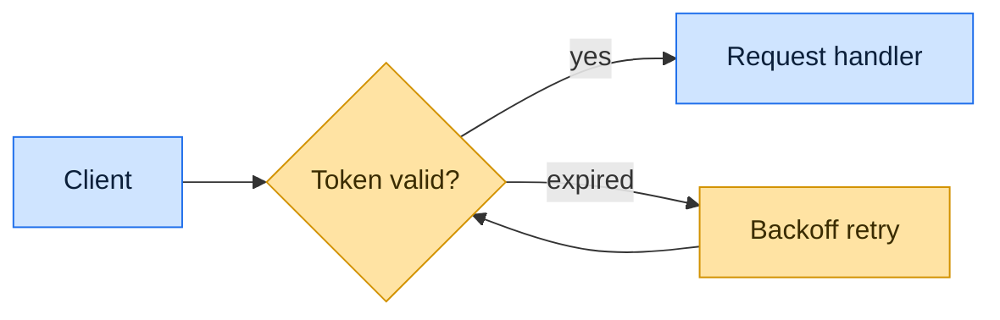

The title and description should make the PR easier to review. Briefly state the change and why it is needed, then add
only context the reviewer cannot readily infer from the diff or CI.

## Base

Diff against the merge base with the default branch, using the `upstream` remote when it exists and `origin` otherwise:

```bash
remote=$(git remote | grep -qx upstream && echo upstream || echo origin)
git rev-parse -q --verify "$remote/HEAD" >/dev/null || git remote set-head "$remote" --auto
base=$(git rev-parse --abbrev-ref "$remote/HEAD")
```

## Title Format

Follow Commitizen conventions with one emoji matching the change type, as in the `/commit` skill:

```
<emoji> <type>(<scope>): <short summary>
```

**Types**: feat, fix, docs, style, refactor, perf, test, build, ci, chore, revert

**Examples**:

- `✨ feat(auth): add OAuth2 support for third-party logins`
- `🐛 fix(api): resolve race condition in request handler`
- `♻️ refactor(core): simplify state management flow`

Keep titles under 72 characters.

## Description Format

Prefer concise prose over bullet-point walls. A small PR may need only one or two sentences. Run the title and body
through `/no-slop` before publishing; the reviewer should not have to edit generated prose to find the useful context.

**Review context**:

State the problem and intended outcome briefly. Explain why this implementation was chosen when the reason is not
apparent from the code: upstream constraints, compatibility requirements, prior art, or a trade-off between plausible
alternatives. Research and link the dependency documentation, upstream issues, specifications, or earlier work that
supports the decision. Put that context directly in the description rather than asking the user to copy it in.

For larger changes, include an architecture overview or Mermaid diagram when it reduces the reviewer's effort. Scale the
explanation to the change; do not fill a fixed template or describe functions, files, and edits in sequence.

Judge descriptions by their usefulness, regardless of whether an agent helped write them. PRs that ignore this guidance
may be closed without feedback. This is a writing standard, not authorization to close PRs or post review comments.

**Formatting**:

- Do not start with a header like "## Summary"
- Use backticks \`\` for quoting code, variables, file names, and technical terms (not double quotes "")
- Never hard-wrap the body. Write each paragraph as one physical line — GitHub renders the markdown, so manual line
  breaks mid-paragraph show up as broken lines in the rendered PR
- Only state what the diff or a reference proves. No speculation about behavior, performance, or intent, and no
  marketing or hype language
- When a reference exists (issue, ticket, design doc, spec, benchmark, prior PR or commit), weave the link into the
  sentence it supports rather than dumping it in a footer
- Set the body from a file: write it with the Write tool, then `gh pr create/edit --body-file <file>`. Never pass the
  body inline (`--body "..."` or a heredoc) — the shell runs backticks and `$(...)` as command substitution and mangles
  every code span. A file avoids all shell escaping

**Avoid**:

- Routine validation reports, test counts, coverage totals, and CI status
- Implementation walkthroughs or details already evident from the diff
- Lists of things left unchanged, absent, or deliberately not done
- Conversation history or instructions such as "keep X while linking Y"
- Adding yourself as co-author
- Bullet-point lists of file changes

**Illustrative example** (follow the format; take the content and length from the change):

```
Allow longer OAuth consent steps. The login token can expire while the user is still at the provider.
```

## Diagrams

Include a mermaid diagram only when the graph is non-trivial and genuinely makes the change easier to grasp than prose
alone — architecture, request/data flow, state transitions, or how components relate. Skip it for trivial or
self-evident graphs (a couple of nodes, a linear A→B→C flow) and never add one just to decorate.

Color the diagram so it is easy on the eye and stays legible in both GitHub light and dark themes. Don't rely on default
theme colors — they wash out on one side. Set explicit fills with `classDef`, using soft mid-tone fills, a saturated
stroke, and dark text (`color:#...`) so contrast holds on both white and dark backgrounds. Use a small palette (2-3
classes) to group node types; keep fills muted, not neon.



## Labels

Pick applicable labels from `enhancement`, `bug`, `documentation` based on the change type:

- `feat`, `perf`, `refactor`, `style` → `enhancement`
- `fix` → `bug`
- `docs` → `documentation`
- Multiple labels are fine if the PR spans categories

## Workflow

1. Run `git diff "$base"...HEAD` to see all changes
1. Run `git log "$base"..HEAD --oneline` to see commit history
1. Identify the primary purpose (what user/developer problem this solves)
1. Draft title following Commitizen format with emoji
1. Write a brief description of the outcome and rationale, including useful review context
1. Remove details the diff or CI already communicates; verify that each remaining claim and link helps review
1. Determine labels from the change type
1. Create with `gh pr create --title "..." --body-file <file> --label "<labels>"`, or update an existing PR with
   `gh pr edit <number> --title "..." --body-file <file>` and add missing labels
