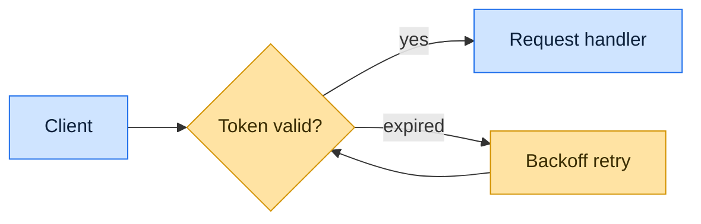

# PR

Start from the full diff (see **Base**). The code documents itself, so the title and description do not explain it.
Write for a product owner: what changes for the people and systems that depend on this work, and why it was worth doing.
The only technical content is the architecture of the solution: which components take on which responsibility and how
they interact. Leave out which files change and how the code achieves it; a reviewer reads that in the diff.

## Base

Diff against the merge base with the default branch, using the `upstream` remote when it exists and `origin` otherwise:

```bash
remote=$(git remote | grep -qx upstream && echo upstream || echo origin)
git rev-parse -q --verify "$remote/HEAD" >/dev/null || git remote set-head "$remote" --auto
base=$(git rev-parse --abbrev-ref "$remote/HEAD")
```

## Title Format

Follow Commitizen conventions with 1-2 relevant emoji:

```text
<emoji> <type>(<scope>): <short summary>
```

**Types**: feat, fix, docs, style, refactor, perf, test, build, ci, chore, revert

**Examples**:

- `✨ feat(auth): add OAuth2 support for third-party logins`
- `🐛 fix(api): resolve race condition in request handler`
- `♻️ refactor(core): simplify state management flow`

Keep titles under 72 characters. The emoji goes at the start; pick one that matches the change type.

## Description Format

Prefer paragraphs. When the content is a set of parallel items (rollout steps, open questions, options), distill it into
a short bullet list instead. Use rich formatting where it makes a paragraph easier to read: **bold** for the one term a
reader must not miss, _italics_ for a defined term, `>` quotes for upstream text you rely on, and indentation for nested
detail.

Do not start with a header. A long description separates its main topics (for example impact, architecture, rollout)
with `###` headings after the opening paragraph. Use 1-3 emoji sparingly throughout to highlight key points. Once the
title and body are drafted, strip the AI slop out of them before creating or updating the PR. The `no-slop` skill does
that where it is installed; otherwise work through the **Avoid** list below by hand.

**Structure**:

1. **Opening paragraph**: State the motivation and the impact, from the product owner's point of view. What problem did
   users, operators or dependent teams have, and what can they do, or stop worrying about, once this merges?

2. **Architecture paragraph**: Describe the design at the level of components and responsibilities: what owns what, how
   the parts talk to each other, and the trade-off behind that shape. No file names, function names, or step-by-step
   mechanics.

3. **Impact paragraph** (if applicable): Note behavior changes someone outside the code would notice, and rollout or
   migration steps.

**Formatting**:

- Use backticks \`\` for quoting code, variables, file names, and technical terms (not double quotes "")
- Link each external repo, service, tool or standard at its first mention; put later mentions in backticks, and spell a
  project by its published name (`requests-oauthlib`, not `requests_oauthlib`). Mermaid labels follow the same naming
- Keep every paragraph under 100 words. When one grows past that, split it at a change of topic
- Never hard-wrap the body. Write each paragraph as one physical line: GitHub renders the markdown, so manual line
  breaks mid-paragraph show up as broken lines in the rendered PR
- Only state what the diff or a reference proves. Don't speculate about behavior, performance, or intent you can't back
  up
- Link every claim about context, or about how something outside this repo behaves, inside the sentence it supports, not
  in a footer. Look for the issue, ticket, design doc, spec, benchmark, prior PR or commit, and for the upstream
  dependency's own source (a permalink to the exact lines), documentation or release notes that show the behavior the
  change relies on. A reviewer should be able to check each statement in one click
- Set the body from a file: write it with the Write tool, then `gh pr create/edit --body-file <file>`. Never pass the
  body inline (`--body "..."` or a heredoc): the shell runs backticks and `$(...)` as command substitution and mangles
  every code span. A file avoids all shell escaping

**Avoid**:

- Mentioning tests or test coverage
- Explaining the code: what specific files, functions or methods do, or how the change is implemented step by step
- Adding yourself as co-author
- Starting with a header like "## Summary" (headings come after the opening paragraph, and only in long descriptions)
- Bullet-point lists of file changes
- Hard-wrapping paragraphs with manual mid-paragraph newlines
- Marketing or hype language, and any claim or assumption not grounded in the diff or a cited reference
- AI slop: filler phrases, throat-clearing openers, emphasis crutches, adverbs, vague declaratives, em dashes, passive
  voice, "not X but Y" contrasts, false agency (inanimate objects doing human verbs)

**Good example**:

```markdown
Google sign-ins landed on an error page: the session token expired before the OAuth callback completed. 🔐

It got worse as more users signed in from far away, where network latency is higher.

The fix extends token validity during the OAuth flow and retries the callback handler. ✨

This keeps the security model while tolerating real-world network latency.

Existing sessions remain unaffected. The retry logic uses exponential backoff to avoid hammering the auth provider.
```

## Diagrams

Diagrams belong with the architecture paragraph. Add a mermaid diagram when the design has enough moving parts that a
picture explains it faster than prose: components and who owns what, a request or data flow across them, state
transitions, or a before/after of the structure. Skip it for trivial or self-evident graphs (a couple of nodes, a linear
A→B→C flow), and never add one just to decorate; a PR with no meaningful graph has no diagram.

Color the diagram so it is easy on the eye and stays legible in both GitHub light and dark themes. Don't rely on default
theme colors; they wash out on one side. Set explicit fills with `classDef`, using soft mid-tone fills, a saturated
stroke, and dark text (`color:#...`) so contrast holds on both white and dark backgrounds. Use a small palette (2-3
classes) to group node types; keep fills muted, not neon.



## Labels

Pick applicable labels from `enhancement`, `bug`, `documentation` based on the change type:

- `feat`, `perf`, `refactor`, `style` → `enhancement`
- `fix` → `bug`
- `docs` → `documentation`
- Multiple labels are fine if the PR spans categories

## Workflow

### Creating a new PR

1. Run `git diff "$base"...HEAD` to see all changes
2. Run `git log "$base"..HEAD --oneline` to see commit history
3. Identify the primary purpose (what user/developer problem this solves)
4. Draft title following Commitizen format with emoji
5. Write description paragraphs: the impact and why, then the architecture
6. Determine labels from the change type
7. Create with:

```bash
gh pr create --title "..." --body-file <file> --label "<labels>"
```

### Updating an existing PR

1. Run `git diff "$base"...HEAD` to see all changes
2. Run `git log "$base"..HEAD --oneline` to see commit history
3. Identify the primary purpose (what user/developer problem this solves)
4. Draft title following Commitizen format with emoji
5. Write description paragraphs: the impact and why, then the architecture
6. Determine labels from the change type
7. Update with `gh pr edit <number> --title "..." --body-file <file>` and add missing labels
