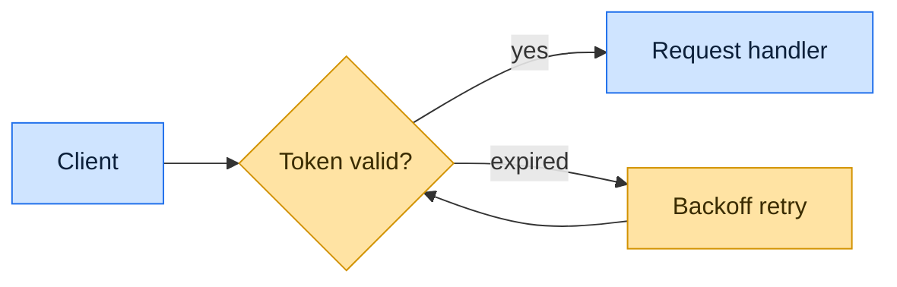

The title and description should communicate the value and reasoning behind the changes, not describe what the code does
line-by-line.

## Base

Diff against the merge base with the default branch, using the `upstream` remote when it exists and `origin` otherwise:

```bash
remote=$(git remote | grep -qx upstream && echo upstream || echo origin)
git rev-parse -q --verify "$remote/HEAD" >/dev/null || git remote set-head "$remote" --auto
base=$(git rev-parse --abbrev-ref "$remote/HEAD")
```

## Title Format

Follow Commitizen conventions with one emoji matching the change type, as in the `/commit` skill:

```
<emoji> <type>(<scope>): <short summary>
```

**Types**: feat, fix, docs, style, refactor, perf, test, build, ci, chore, revert

**Examples**:

- `✨ feat(auth): add OAuth2 support for third-party logins`
- `🐛 fix(api): resolve race condition in request handler`
- `♻️ refactor(core): simplify state management flow`

Keep titles under 72 characters.

## Description Format

Write in paragraphs, not bullet lists. Use 1-3 emoji sparingly throughout to highlight key points. Once the title and
body are drafted, run them through the `/no-slop` skill and apply its edits before creating or updating the PR.

**Structure**:

1. **Opening paragraph**: State the motivation. Why was this change needed? What problem does it solve? What's the user
   or developer benefit?

1. **Approach paragraph**: Explain how the solution works at a high level. Focus on the design decisions and trade-offs,
   not implementation details.

1. **Impact paragraph** (if applicable): Note any behavioral changes, migration steps, or things reviewers should pay
   attention to.

**Formatting**:

- Do not start with a header like "## Summary"
- Use backticks \`\` for quoting code, variables, file names, and technical terms (not double quotes "")
- Never hard-wrap the body. Write each paragraph as one physical line — GitHub renders the markdown, so manual line
  breaks mid-paragraph show up as broken lines in the rendered PR
- Only state what the diff or a reference proves. No speculation about behavior, performance, or intent, and no
  marketing or hype language
- When a reference exists (issue, ticket, design doc, spec, benchmark, prior PR or commit), weave the link into the
  sentence it supports rather than dumping it in a footer
- Set the body from a file: write it with the Write tool, then `gh pr create/edit --body-file <file>`. Never pass the
  body inline (`--body "..."` or a heredoc) — the shell runs backticks and `$(...)` as command substitution and mangles
  every code span. A file avoids all shell escaping

**Avoid**:

- Mentioning tests or test coverage
- Describing what specific functions or methods do
- Adding yourself as co-author
- Bullet-point lists of file changes

**Good example**:

```
Users signing in with Google accounts were redirected to an error page because the session token expired before the OAuth callback completed. 🔐 This became more frequent as our user base grew internationally, where network latency is higher.

The fix extends the token validity window during the OAuth flow and adds a retry mechanism for the callback handler. ✨ This approach preserves our security model while accommodating real-world network conditions.

Existing sessions remain unaffected. The retry logic uses exponential backoff to avoid hammering the auth provider.
```

## Diagrams

Include a mermaid diagram only when the graph is non-trivial and genuinely makes the change easier to grasp than prose
alone — architecture, request/data flow, state transitions, or how components relate. Skip it for trivial or
self-evident graphs (a couple of nodes, a linear A→B→C flow) and never add one just to decorate.

Color the diagram so it is easy on the eye and stays legible in both GitHub light and dark themes. Don't rely on default
theme colors — they wash out on one side. Set explicit fills with `classDef`, using soft mid-tone fills, a saturated
stroke, and dark text (`color:#...`) so contrast holds on both white and dark backgrounds. Use a small palette (2-3
classes) to group node types; keep fills muted, not neon.



## Labels

Pick applicable labels from `enhancement`, `bug`, `documentation` based on the change type:

- `feat`, `perf`, `refactor`, `style` → `enhancement`
- `fix` → `bug`
- `docs` → `documentation`
- Multiple labels are fine if the PR spans categories

## Workflow

1. Run `git diff "$base"...HEAD` to see all changes
1. Run `git log "$base"..HEAD --oneline` to see commit history
1. Identify the primary purpose (what user/developer problem this solves)
1. Draft title following Commitizen format with emoji
1. Write description paragraphs explaining why and how
1. Determine labels from the change type
1. Create with `gh pr create --title "..." --body-file <file> --label "<labels>"`, or update an existing PR with
   `gh pr edit <number> --title "..." --body-file <file>` and add missing labels
