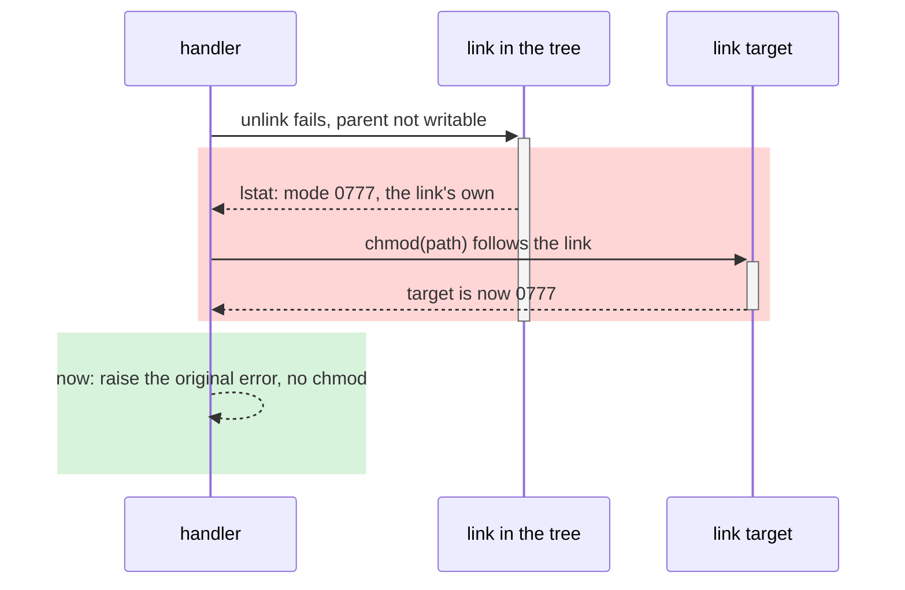
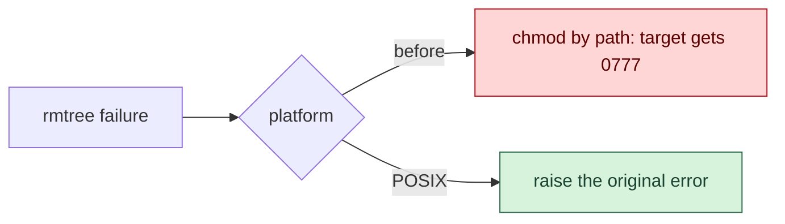

Work in the repository the report concerns, or the current repository when none is named. The user provides the report
(a file, a pasted text, a URL, or an advisory); never go looking for reports on your own.

## Triage

1. Split the report into findings. Keep the reporter's identifier for each (for example `ANT-2026-UK90QC27`) and the
   version or commit it was tested against.
1. Before validating, search the repository's existing advisories (`gh api repos/{owner}/{repo}/security-advisories`),
   open and closed issues, and open PRs for each finding. Report a finding already tracked to the user with its link,
   and do not open it again.
1. Validate each finding against the code, never against the report's own narrative. Read the code path at the reported
   commit and at the default branch head, then reproduce the behavior in an isolated worktree: run the reporter's
   reproducer when one exists, otherwise write the smallest one that shows the claimed effect. Use a disposable
   container for reproducers that change user IDs, write outside the worktree, or need root. Use `winvm` for anything
   that only happens on Windows. Record the commands and their output; they become the evidence below.
1. Classify each finding:
   - **Invalid**: the reproducer does not show the claimed effect, the code path is unreachable, or the behavior is
     documented and intended. Report it to the user with the evidence and stop there.
   - **Bug**: the behavior is wrong, but an attacker gains nothing they did not already have, for example the
     precondition already grants the same access, or only the invoking user can trigger it against themselves.
   - **Security**: the behavior lets someone cross a trust boundary: read, write, execute or deny something they could
     not before. Name the attacker, what they must already control, and what they gain. A finding whose precondition
     already implies the gain is a bug, not a vulnerability.
1. Rate each valid finding on two axes, and give the reason for each rating:
   - **Reproducibility**: *easy* (default options, one command, any platform), *moderate* (a specific configuration,
     platform or version), or *hard* (a race, a narrow timing window, or a setup that took several tries).
   - **Real-world exposure**: *common* (users hit this in ordinary workflows, or an attacker can set up the precondition
     without help), *niche* (an unusual but plausible setup, such as a shared machine or a reused directory), or
     *unlikely* (needs a precondition few users have, or one that already grants most of what the attacker gains).
     Ground the rating in how the project is used: its documentation, issue history, and the defaults a typical user
     runs with.
1. Present the classification to the user, one line per finding with its verdict, both ratings, and the deciding
   evidence, before opening anything. Proceed without waiting unless the user asks to stop; a later disagreement
   reclassifies the finding.

## Fix

1. Fix each valid finding on its own branch from the default branch, so each PR carries one finding. Follow the
   repository's instructions and conventions, add a test that fails before the fix and passes after, and update every
   documentation page the fix makes inaccurate. Run `/simp` over the diff and the repository's checks, then commit with
   `/commit`.
1. Push the branch. When the finding is a vulnerability, create the advisory (below) before opening the PR, so the PR
   can link it; then open the PR and add its link to the advisory.

## Advisory

Open a draft repository advisory for each vulnerability. A draft stays private to the repository's maintainers and any
collaborators added to it until someone publishes it; never publish it or request a CVE yourself.

```bash
gh api -X POST repos/{owner}/{repo}/security-advisories --input advisory.json
```

`advisory.json` holds `summary` (one line, under 100 characters, the effect rather than the mechanism, for example
`Builtin creation follows linked environment directories`), `description` (the body below), `cvss_vector_string` (a CVSS
3.1 vector you justify metric by metric from the reproduction; when the evidence leaves a metric between two values,
pick the less severe one, so the score errs low rather than high), `cwe_ids`, and `vulnerabilities` with the package
`ecosystem` and `name`, the `vulnerable_version_range` you confirmed, and `patched_versions` left empty until a release
ships the fix. Write the body to a file and pass it as JSON; never inline it in the shell. After the PR exists, update
the advisory with `gh api -X PATCH repos/{owner}/{repo}/security-advisories/{ghsa_id} --input advisory.json` to link it.

Structure the description after
[GHSA-cw65-gx24-rc82](https://github.com/pypa/virtualenv/security/advisories/GHSA-cw65-gx24-rc82), with these `##`
sections in this order:

1. **Summary**: the flaw and its effect in two or three sentences, then who reported it, the report identifier, and the
   date it was received.
1. **Affected area**: the feature or phase of operation, in one line.
1. **Attacker-controlled input**: what the attacker must already control, and what they do not need.
1. **Affected code**: permalinks pinned to the affected release's commit.
1. **Mechanism**: how the input reaches the effect, step by step, with links to the dependency source, documentation or
   man pages each step relies on. Name the narrow cases that stay out of scope.
1. **Reproduction and evidence**: what you ran, against which commit, and what it printed.
1. **Attack sequence**: a sequence diagram (see **Diagrams**).
1. **Reproducer files**: each file in full, in a fenced block under its bolded path, and how to run it.
1. **Impact**: what the attacker gains, what is not established, and how likely real users are to meet the precondition
   (the exposure rating), then `Severity:` with the CVSS score and vector.
1. **Versions tested**: the releases confirmed affected, without extrapolating to untested ones, and the fix in one
   paragraph with the PR link.
1. **Known mitigation**: what users can do before upgrading.
1. **Affected release**: a checked box per release that reproduces.
1. **Credits**: the reporter and identifier.

## PR

Open one public PR per valid finding with `/pr` for the title format, link and formatting rules, and the body-file
workflow. For this skill the body follows the structure of
[pypa/virtualenv#3427](https://github.com/pypa/virtualenv/pull/3427) rather than `/pr`'s product-owner paragraphs, and
it names the functions and lines involved:

1. **Opening paragraph**: what the code did, with a permalink to the old lines at the merge base, what that let happen
   and to whom, and what happens after the PR. A vulnerability ends the paragraph with
   `This addresses [draft advisory <report id>](<advisory URL>).` A link to a draft advisory only works for people who
   can see it; that is intended.
1. **`###` sections on the mechanism**: one per cause or per platform, each titled with its finding (for example
   `### The retry changed the mode of the link's target`). Explain the old behavior with links to the dependency docs,
   man pages or source that prove each step, then the new behavior with permalinks to the PR head. Permalinks to new
   lines need the pushed head SHA: push first, then write the body, and refresh the SHAs whenever the head moves.
1. **`### Behavior changes`**: what users, callers and each platform observe now, including new errors and the cases the
   fix does not cover.
1. **Closing line**: `Reported by <reporter>: <report id>.`

Keep exploit material out of the public PR: the reproducer files and step-by-step attack recipe stay in the private
advisory. The PR explains the flaw well enough to review the fix.

Labels: `security` and `bug` for a vulnerability, `bug` alone for a bug. If the repository has no `security` label, ask
the user before creating one.

## Diagrams

Use mermaid where a picture explains faster than prose: a flaw that crosses components, an ordering or race, or a branch
that differs by platform or input. Never draw a two-node or linear chain that one sentence states. A finding that needs
no picture gets none.

- An advisory's **Attack sequence** is always a sequence diagram, from the attacker's preparation to the effect.
- In a PR, use a sequence diagram when the flaw is an ordering of calls between participants, and a flowchart when it is
  a decision with branches. Show the old path and the new path in the same diagram.
- Sequence diagrams use activations (`+`/`-` on messages, or `activate`/`deactivate`) to show which participant holds
  control and for how long, and `rect` blocks to separate the harmful window from the fixed behavior.
- Colors must stay legible in GitHub's light and dark themes: soft fills, a saturated stroke, dark text. Use red for the
  harmful path and green for the fixed one, and keep to two or three classes.





## Prose

Read `/no-slop` in full, with every reference it points to, and apply each instruction and listed pattern by hand to the
advisory summary and body, every PR title and body, every commit message, and the report to the user. Run its scorer as
well, but a passing `GATE` is not the end of the pass: work through the `ADVISORY` and `VOICE` findings and the patterns
the scorer cannot check. Repeat the pass after every edit. Check each claim against the evidence; a sentence nothing
proves comes out.

## Review and green

1. Review each PR adversarially with `/rev`, by number. It puts its fixes in one commit on top of the head, runs
   `/style` over the final diff, and updates the PR metadata; re-check that the body still follows **PR** afterwards.
1. Drive each PR to green: watch its checks with `gh pr checks <n> --watch`, read the logs of every failure
   (`gh run view <id> --log-failed`), reproduce it locally or on `winvm`, fix the cause in a new commit, and push. Do
   not skip, disable or mark a check optional to make it pass. Retry a job only when its log shows an infrastructure
   failure, and say so. Stop and report when a failure is outside the PR's control.
1. Never post PR comments, review comments or reviews; findings become commits.

## Report

Finish with one line per finding: its report identifier, the verdict, both ratings, the advisory link for a
vulnerability, the PR link and its check state, and anything left for the user, such as publishing the advisory or
requesting a CVE.
